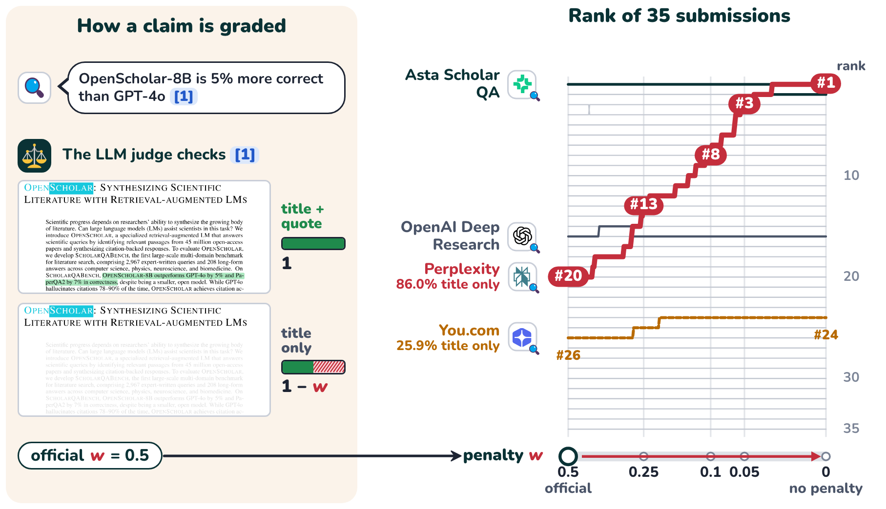

# One citation rule moves Perplexity from #20 to #1 on AstaBench ScholarQA-CS2

ScholarQA-CS2 is the long-form literature QA benchmark in AstaBench (Bragg et al., ICLR 2026,
[arXiv 2510.21652](https://arxiv.org/abs/2510.21652)). An LLM judge scores each answer on four parts, and the
leaderboard ranks systems by their average. One part of the scoring gives a claim half credit when its citation has
a title but no supporting quote. AstaBench states this rule but does not report how much the ranking depends on it.

In this work, I take the saved judge decisions from 35 public ScholarQA-CS2 submissions and change only that rule.
No answer is regenerated and no claim is judged again. Perplexity Sonar Deep Research gets half credit on 86.0% of
its claims. Without the penalty it moves from #20 to #1, above every Asta Scholar QA configuration. With a penalty
of 0.1 it ranks #8. Every other system has under 2.5% of its claims at half credit and keeps its place. One
constant in the grading decides where a whole class of systems lands on the leaderboard.



*Figure 1. Left: a claim whose citation has a title but no supporting quote keeps 1 − w of its credit (official
w = 0.5). The claim is illustrative; the page excerpts are from OpenScholar (Asai et al., 2024,
[arXiv 2411.14199](https://arxiv.org/abs/2411.14199), CC BY 4.0). Right: rank of the 35 public submissions as w
moves from 0.5 to 0 (square-root scale). Perplexity Sonar Deep Research rises from #20 to #1; You.com moves from
#26 to #24. PDF: [`figures/fig1.pdf`](figures/fig1.pdf).*

## How ScholarQA-CS2 scores an answer

The score is the mean of four parts, each judged by an LLM: ingredient recall (coverage of the rubric's points),
answer precision (relevance), citation precision, and citation recall. The two citation parts use this rule
(AstaBench, Section 3):

> "If the LLM judge assesses support based on the cited paper's title but there are no supporting quotes (this can
> happen because the system lacks the quote feature or because the particular sources' texts are unavailable to the
> system e.g. for copyright reasons), the claim receives a score of 0.5."

For a title-only citation, the judge prompt says to mark it as supporting "if the title indicates that the paper is
likely relevant to the claim being considered." AstaBench scored Perplexity as title-only by design:

> "while we found it may be possible to prompt Perplexity Sonar Deep Research to extract quotes in each of its cited
> sources, the API does not explicitly return these snippets; thus, we evaluate the model as if it only cites the
> title and URL of each page."

## Method

The gated dataset `allenai/asta-bench-submissions` keeps each submission's evaluation log, including the judge's
decision for every claim and the list of title-only citations. `scripts/quote_rule.py` recomputes citation recall
and precision with the formulas in Ai2's
[`citation_eval.py`](https://github.com/allenai/asta-bench/blob/main/astabench/evals/sqa/citation_eval.py), then
again with the half-credit penalty w set to other values (official w = 0.5). The final score is linear in w, so
`scripts/rerank_quote_rule.py` ranks all 35 submissions at each w.

## Results

Perplexity's rank as the penalty changes:

| Penalty w | 0 | 0.05 | 0.1 | 0.25 | 0.5 (official) |
|---|---|---|---|---|---|
| Perplexity Sonar Deep Research | #1 | #3 | #8 | #13 | #20 |

Without the penalty, Perplexity's citation recall goes from 44.0 to 86.9 and its citation precision from 49.5 to
97.9. Its overall score goes from 70.4 to 93.2. The top Asta Scholar QA run goes from 91.9 to 92.2.

The rule matters for few systems. You.com Research API has 25.9% of its claims at half credit and moves from #26 to
#24. All other systems are under 2.5%. OpenAI Deep Research also has a low citation score, but only 1.7% of its
claims get half credit: the judge marks 48.8% of its claims as not supported, so the rule does not explain its
place.

Removing the penalty is not the right setting either. A title is weaker evidence than a quote, and the judge
accepts a title when the paper is "likely relevant". The finding is that the leaderboard place of a system without
quotes is set by w, and w is a design choice.

## A second check: how the four parts are combined

`scripts/aggregation_check.py` uses only the public per-system results (`allenai/asta-bench-results`, 41 runs)
and changes how the four part scores are combined. Outputs and judgments stay the same.

| Combination | Winner | Kendall tau with official | Top-10 pairs reversed |
|---|---|---|---|
| Mean of 4 (official) | Asta Scholar QA w/ tables (gpt-5.4) | 1.000 | 0 of 45 |
| Coverage and relevance only | OpenAI Deep Research | 0.649 | 20 of 45 |
| Citation parts only | ReAct (gpt-5.4) | 0.785 | 12 of 45 |
| Without citation recall | Asta Scholar QA w/ Tables (o3) | 0.829 | 16 of 45 |
| Harmonic mean of 4 | Asta Scholar QA w/ tables (gpt-5.4) | 0.944 | 3 of 45 |

On coverage and relevance alone, OpenAI Deep Research moves from #20 to #1 and ReAct with gpt-5.4 drops from #3
to #20. The official order is set mostly by citation recall.

## Limits

- Citation recall is recomputed partly from the reported value, because sentences with no citation are not in the
  logs. It is not an independent check of the official number. My recomputed citation precision matches the
  official value within 0.3 points for most runs and is up to 8 points off for some ReAct and Smolagents runs, so
  the re-ranking adds my computed change to the official precision. Runs with no title-only claims do not change.
- The public results (41 runs) and the gated submissions (35 runs) are not the same set, so ranks differ slightly
  between the two sections.
- At the top of the coverage-and-relevance ranking, runs are within about 1.5 points, which is inside the noise.
- I have not checked by hand whether Perplexity's title-only citations are relevant. That check would show how much
  credit they deserve.

## Related work from the Asta team

The ScholarQA-CS2 meta-evaluation (Hwang et al., [arXiv 2603.06942](https://arxiv.org/abs/2603.06942)) describes
the half-credit rule and compares citation scores with expert labels. It reports agreement of 69% for citation
recall and 75% for citation precision, with "the LLM judge typically more lenient than human assessors." It does not
vary the half-credit value. AstaBench reports that rubrics built without a system's answers lower that system's
score by 2.5 to 5 points, and says "more investigation is necessary."

## Reproduce

```
bash scripts/download_public_results.sh          # public, no login
python3 scripts/extract_sqa.py                   # -> results/sqa_scores.csv
python3 scripts/aggregation_check.py

pip install huggingface_hub
python3 scripts/download_submissions.py          # gated: accept the terms on the dataset page first
python3 scripts/quote_rule.py data/submissions results/quote_rule.csv
python3 scripts/rerank_quote_rule.py
```

The submissions dataset terms forbid redistribution, so this repository contains no submission data and no tables
computed from it beyond the numbers in this README and the ranks drawn in Figure 1.
